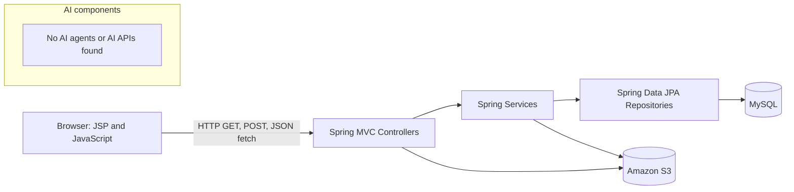
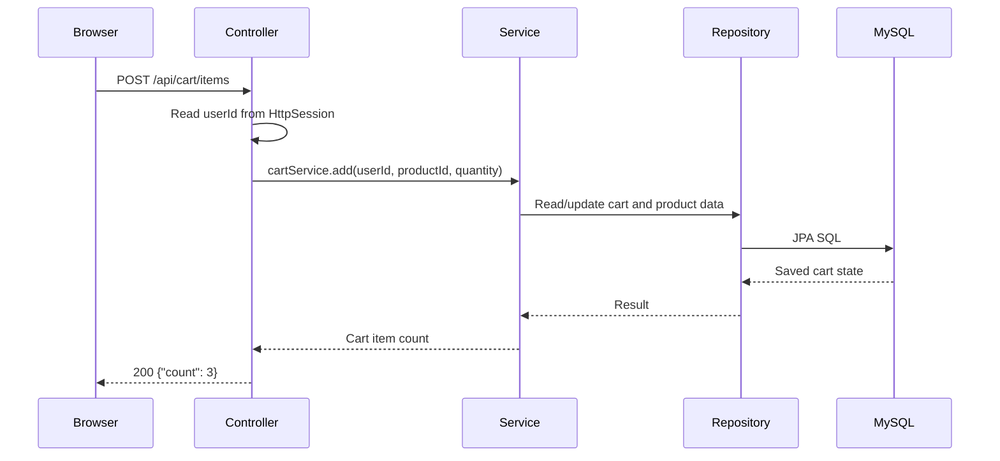

~~# Aalmari Shopping

A full-stack Java Spring Boot marketplace for customers, sellers, flash sales, COD checkout, order management, and seller finance.

## 1. Overview

Aalmari Shopping provides an ecommerce marketplace with separate customer and seller workflows. Customers can register, browse products, search, maintain a cart and wishlist, save addresses, place COD orders, and view orders. Sellers can submit store documentation, manage products and flash sales, process order lines, and review finance summaries.

### Target users

- **Customers:** browse and purchase products, manage profiles, carts, wishlists, addresses, and orders.
- **Sellers:** create a store, upload products, run flash sales, and manage seller orders and finance.
- **Developers and recruiters:** inspect or extend the Spring MVC/JPA ecommerce implementation.

### Key features

- User registration and session-based login/logout
- BCrypt password hashing
- Homepage products and hero slides
- Category browsing and search suggestions
- Product details, wishlist, and shopping cart
- Saved delivery addresses and Cash on Delivery checkout
- Buy-now and cart checkout paths
- Seller onboarding and verification status
- Product CRUD and S3 image uploads
- Flash sales, inventory limits, and flash-purchase claims
- Seller order status updates and finance summaries
- Customer and seller profile views

## 2. Tech Stack

| Area | Technology | Evidence |
|---|---|---|
| Language | Java 21 | `pom.xml` |
| Backend framework | Spring Boot 3.2.5, Spring MVC | `pom.xml` |
| Persistence | Spring Data JPA and Hibernate | `pom.xml`, `application.properties` |
| Database | MySQL | `application.properties` |
| Views | JSP and JSTL | `pom.xml`, `src/main/webapp` |
| Frontend | HTML5, CSS3, JavaScript | `src/main/resources/static`, JSP files |
| Passwords | Spring Security BCrypt | `PasswordEncoderConfig.java` |
| File storage | AWS SDK for Java v2, Amazon S3 | `pom.xml`, `S3Config.java`, `S3Service.java` |
| Server packaging | Embedded Tomcat, WAR | `pom.xml` |
| Build tool | Maven Wrapper | `mvnw.cmd`, `pom.xml` |
| AI models/APIs | None found | No AI SDK or agent framework is declared |

## 3. Architecture

The application follows a server-rendered Spring MVC architecture. JSP pages and JavaScript call Spring controllers. Controllers use services and repositories, and repositories use JPA/Hibernate to access MySQL. AWS S3 stores seller, profile, verification, and product files.

Authentication is session-based: `HttpSession` stores `userId` and profile fields. The project does not use a Spring Security filter chain.



## 4. AI Agents

**No AI agents are implemented in this codebase.**

No OpenAI, Anthropic, Gemini, Spring AI, LangChain, Ollama, LLM, prompt, or tool-call implementation was found under `src`. The following items are not AI agents:

- **Spring services:** application business components such as `CartService`, `OrderService`, and `FlashSaleService`.
- **Spring MVC controllers:** HTTP request handlers, not autonomous agents.
- **Customer support JSPs:** UI pages such as `support.jsp`; no chatbot or automated assistant implementation is present.
- **Delivery-agent text:** product copy or delivery status terminology, not executable agent code.

### AI-agent contract

All agent fields requested by this document are marked as not applicable because no agent framework or model exists:

| Field | Status |
|---|---|
| Name and purpose | TODO: confirm whether an agent will be added |
| Trigger | Not applicable; no agent entry point exists |
| Inputs and outputs | Not applicable; no agent request/response schema exists |
| Tools | Not applicable; no agent tool definitions exist |
| Model | Not applicable; no AI model or API is configured |
| System prompt and key instructions | Not applicable; no agent prompt was found |
| Memory/state | HttpSession is web-session state, not AI-agent memory |
| Error handling | Not applicable; no AI-agent error flow exists |
| Inter-agent communication | Not applicable; no agents or agent service bus exist |

## 5. Agent Workflow

There is no AI-agent workflow. The real application workflow is an HTTP request flow:

1. A browser sends a GET or POST request or calls a JSON endpoint with `fetch()`.
2. A Spring MVC controller receives the request.
3. The controller reads authenticated identity from `HttpSession` where required.
4. It delegates business logic to a service.
5. A JPA repository reads or updates MySQL entities.
6. For file operations, `S3Service` uploads or deletes S3 objects.
7. The controller returns a JSP view, redirect, or JSON/HTTP response.



### End-to-end checkout example

1. The logged-in customer opens `/checkout`.
2. The browser loads a saved address and the current cart or buy-now view.
3. The customer submits `/checkout/place` with an address ID and `paymentMethod: COD`.
4. `CheckoutController` validates the form and session user.
5. `OrderService` validates stock and flash limits, creates order snapshots, updates inventory, records flash purchases, and clears the cart as appropriate.
6. The customer is redirected to `/checkout/success?orderId=<id>`.

## 6. Project Structure

```text
Aalmari_Shopping/
├── mvnw.cmd                         # Windows Maven Wrapper
├── pom.xml                          # Maven dependencies and WAR build
├── PROJECT.md                       # This project documentation
├── README.md                        # Existing maintainer context and operations guide
├── application.properties           # Runtime properties, under src/main/resources
├── src/
│   ├── main/
│   │   ├── java/com/example/aalmari/
│   │   │   ├── AalmariApplication.java  # Spring Boot entry point
│   │   │   ├── config/              # Password encoder and AWS S3 configuration
│   │   │   ├── controller/          # MVC and REST request handlers
│   │   │   ├── dto/                 # Request/result projections
│   │   │   ├── model/               # JPA entities
│   │   │   ├── repository/          # Spring Data JPA repositories
│   │   │   └── service/             # Business logic and S3 implementation
│   │   ├── resources/
│   │   │   ├── application.properties   # Server, database, AWS, upload settings
│   │   │   └── static/              # CSS and JavaScript assets
│   │   └── webapp/
│   │       ├── HomePageImages/      # Homepage image assets
│   │       ├── WEB-INF/components/  # Reusable JSP components
│   │       └── WEB-INF/views/       # Page JSP templates
│   └── test/                        # TODO: confirm test source placement; no files found
└── target/                          # Maven build output and generated WAR
```

## 7. Getting Started

### Prerequisites

- Windows PowerShell or a compatible shell
- JDK 21
- MySQL 8 or a compatible MySQL instance
- AWS credentials only for S3-backed uploads or profile URLs
- Maven Wrapper support included in the repository

### Install

Clone or open the repository, then verify Java:

```powershell
java -version
```

Expected major Java version: `21`.

### Environment variables

Set the variables in PowerShell before starting the application:

| Variable | Required | Purpose | Example |
|---|---:|---|---|
| `aalmari_database_url` | Yes | JDBC MySQL URL | `jdbc:mysql://localhost:3306/aalmari_shopping` |
| `aalmari_database_username` | Yes | Database user | `root` |
| `aalmari_database_password` | Yes | Database password | `your-mysql-password` |
| `AWS_ACCESS_KEY_ID` | For S3 | AWS access key | `your-replacement-access-key` |
| `AWS_SECRET_ACCESS_KEY` | For S3 | AWS secret key | `your-replacement-secret-key` |

PowerShell example:

```powershell
$env:aalmari_database_url="jdbc:mysql://localhost:3306/aalmari_shopping"
$env:aalmari_database_username="root"
$env:aalmari_database_password="your-mysql-password"

# Set these only when using AWS S3.
$env:AWS_ACCESS_KEY_ID="your-replacement-access-key"
$env:AWS_SECRET_ACCESS_KEY="your-replacement-secret-key"
```

Do not commit real credentials. An `.env.example` file was not found.

### Database setup

Create or select the configured database:

```sql
CREATE DATABASE IF NOT EXISTS aalmari_shopping;
```

Hibernate is configured with:

```properties
spring.jpa.hibernate.ddl-auto=update
```

This may create or update tables automatically. Confirm the database backup policy and schema migration process for production.

### Run on Windows

From the project root:

```powershell
.\mvnw.cmd spring-boot:run
```

Open:

```text
http://localhost:8080
```

JSP support means the application should be run with `spring-boot:run` rather than relying only on an executable JAR.

### Build the WAR

```powershell
.\mvnw.cmd clean package
```

The configured artifact is written under `target/Aalmari_Application.war`.

## 8. Usage

### Register

Open `http://localhost:8080/signin` and submit:

```text
firstName=Jane
lastName=Buyer
email=jane@example.com
country=Country
phone=123456789
password=Minimum8Characters
terms=accepted
```

Success redirects to `/login?registered=true`.

### Log in

Open `/login` and submit an email and password.

Success sets session attributes and redirects to `/`.

### Add an item to the cart

```powershell
Invoke-RestMethod -Method Post `
  -Uri "http://localhost:8080/api/cart/items" `
  -ContentType "application/json" `
  -Body '{"productId":1,"quantity":2}'
```

Example result:

```json
{"count": 2}
```

The browser session must be authenticated and the request must carry the resulting session cookie.

### Get cart count

```powershell
Invoke-RestMethod -Uri "http://localhost:8080/api/cart/count"
```

Guest users receive:

```json
{"count": 0}
```

### Search suggestions

```text
GET /api/search/suggest?q=iph
```

Example result:

```json
["iPhone 15 Pro"]
```

## 9. API Reference

### Authentication pages and actions

| Method | Path | Purpose | Success behavior |
|---|---|---|---|
| GET | `/signin` | Show registration page | JSP `auth/signin` |
| POST | `/register` | Register a user | Redirect to login |
| GET | `/login` | Show login page | JSP `auth/login` |
| POST | `/login` | Authenticate and create session | Redirect to `/` |
| GET | `/logout` | Invalidate session | Redirect to `/login` |

### Cart API

| Method | Path | Input | Result |
|---|---|---|---|
| POST | `/api/cart/items` | JSON `{ "productId": 1, "quantity": 2 }` | `{ "count": 2 }` |
| GET | `/api/cart/count` | Session cookie | `{ "count": N }` |

Unauthenticated cart mutation returns HTTP `401`:

```json
{"error":"Please log in first."}
```

Invalid input returns HTTP `400` with an application-specific error message.

### Wishlist API

| Method | Path | Purpose |
|---|---|---|
| GET | `/api/wishlist/ids` | Return wishlisted product IDs |
| PUT | `/api/wishlist/items/{productId}` | Add one wishlist item |
| DELETE | `/api/wishlist/items/{productId}` | Remove one wishlist item |

Example:

```json
{"wished":true,"count":3}
```

### Search API

| Method | Path | Purpose |
|---|---|---|
| GET | `/api/search/suggest?q=<text>` | Return up to 8 unique product-name suggestions |

Queries shorter than 2 or longer than 60 characters return an empty array. Results are privately cached for 30 seconds.

### Checkout and address routes

| Method | Path | Purpose |
|---|---|---|
| POST | `/checkout/buy-now` | Store buy-now product and quantity in session |
| GET | `/checkout` | Render checkout with cart or buy-now items |
| POST | `/checkout/address/save` | Create or update an address |
| POST | `/checkout/address/delete` | Delete an owned address |
| POST | `/checkout/address/default` | Set the default address |
| POST | `/checkout/place` | Place an order |
| GET | `/checkout/success?orderId=<id>` | Show an owned order confirmation |

Only COD checkout is implemented by the order-placement path. Although the form validation recognizes `ESEWA`, `KHALTI`, and `CARD`, the controller rejects anything except `COD`.

### Admin sales API

| Method | Path | Purpose |
|---|---|---|
| GET | `/api/admin/sales/summary` | Return `AdminSalesSummaryResponse` |

This endpoint allows CORS from `http://localhost:8000` and `http://127.0.0.1:8000`. TODO: confirm its authentication and authorization requirements.

Additional page routes include `/`, `/welcome`, `/cart`, `/categories`, `/searchResult`, seller pages, flash-sale pages, profile pages, and static information pages. TODO: maintain a complete route table if exact controller coverage is required.

## 10. Configuration

### Database

Update `src/main/resources/application.properties` or environment variables:

```properties
spring.datasource.url=${aalmari_database_url}
spring.datasource.username=${aalmari_database_username}
spring.datasource.password=${aalmari_database_password}
```

### AWS S3

Configured properties:

```properties
aws.region=ap-southeast-2
aws.s3.bucket=sellerimages123
aws.s3.profileBucket=aalmari-profile-pic
aws.s3.productImages=aalmari-product-images
```

AWS credentials are resolved in `S3Config`:

1. Use `aws.accessKeyId` and `aws.secretKey` when both are supplied.
2. Otherwise use `DefaultCredentialsProvider`.
3. In `application.properties`, credentials come from `AWS_ACCESS_KEY_ID` and `AWS_SECRET_ACCESS_KEY` with empty defaults.

### AI models and prompts

No AI model, prompt, or agent behavior exists to configure. Do not document or enable a model until one is actually added to the source code.

### Server and uploads

```properties
server.port=8080
spring.mvc.view.prefix=/WEB-INF/views/
spring.mvc.view.suffix=.jsp
spring.servlet.multipart.max-file-size=10MB
spring.servlet.multipart.max-request-size=60MB
```

To change the server port, update `server.port` or supply a Spring property override when starting the application.

## 11. Testing

No `src/test` source files were found, so automated JUnit or Spring test coverage could not be confirmed.

Run the existing Maven verification goal:

```powershell
.\mvnw.cmd test
```

Before adding tests, confirm the preferred framework and database test strategy. Possible test targets include:

- Registration validation and duplicate email handling
- Login session setup and logout
- Cart quantity and stock limits
- Wishlist add/remove behavior
- Address ownership
- COD checkout and order snapshots
- Flash-sale customer limits
- Seller ownership checks
- Search wildcard escaping
- S3 error handling

## 12. Deployment

The Maven build produces a WAR because `<packaging>war</packaging>` is configured.

Build:

```powershell
.\mvnw.cmd clean package
```

Deployment TODOs:

- `Dockerfile`: not found.
- `docker-compose.yml`: not found.
- Cloud/deployment scripts: not found.
- Production profile: not found.
- Database migration tooling: not confirmed; the project currently uses `ddl-auto=update`.
- HTTPS and reverse-proxy configuration: TODO: confirm.
- Secret manager or external configuration: TODO: confirm.

For local WAR/testing behavior, Spring Boot's embedded server can run the packaged application. In a production servlet container, confirm JSP/Tomcat compatibility and deployment context paths.

## 13. Troubleshooting

### Database connection fails

Check all three database environment variables:

```powershell
$env:aalmari_database_url
$env:aalmari_database_username
$env:aalmari_database_password
```

Confirm that MySQL is running and the `aalmari_shopping` database exists.

### Port 8080 is occupied

Change `server.port` in `application.properties`, or stop the process using that port.

### JSP-related run errors

Use `spring-boot:run` because embedded Jasper and JSP support are configured. Verify JDK 21 is active.

### S3 upload or profile URL failures

- Confirm AWS credentials and permissions.
- Profile images require a private-bucket presigned URL and valid `GetObject` permission.
- Product images use the configured `aalmari-product-images` bucket.
- Seller/profile uploads use keys rather than public URLs.
- If credentials were exposed previously, revoke and replace them; never commit replacements.

### Cart or wishlist returns 401

Log in first and keep the session cookie. Do not pass a browser-supplied user ID to user state-changing endpoints.

### Checkout rejects online payments

This is expected: only COD is implemented. Use `paymentMethod=COD`.

### AI-agent errors

No AI-agent code or runtime exists, so there are no AI-agent errors to troubleshoot in the current project.

## 14. Roadmap

Based on confirmed TODOs and comments:

- Confirm or add automated JUnit/Spring tests.
- Add an explicit database migration strategy instead of relying on `ddl-auto=update`.
- Complete real payment integration for eSewa, Khalti, and cards.
- Add production Docker and deployment configuration if required.
- Add authentication and authorization controls for admin/seller endpoints if not already enforced elsewhere.
- Confirm and document the full route map.
- Add AI agents or model integrations only if a future requirement exists.

## 15. License

TODO: confirm. No license file or license declaration was found during the repository scan.~~

